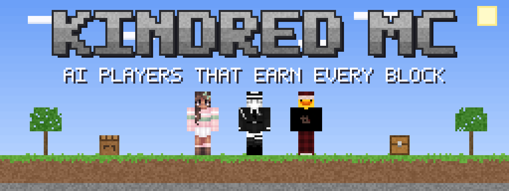

<p align="center">
  
</p>

Kindred adds a player to your Minecraft server that plays survival on its own. It joins like anyone else, with its own skin and inventory, and works its way from punching trees toward the Ender Dragon. It doesn't get free items, teleport, or see through walls. If it has something, it found it, mined it, or crafted it.

Minecraft 1.21.1 · Fabric · Java 21 · still in development

## Getting started

There's no download yet. Build it, drop it in, start the server.

1. Install [Java 21](https://adoptium.net/) and set up a 1.21.1 server with Fabric Loader 0.19.5 and Fabric API 0.116.17+1.21.1.
2. Run `./gradlew build` here (`gradlew.bat build` on Windows).
3. Copy `companion-server-adapter/build/libs/kindred-mc-0.1.0-SNAPSHOT.jar` into the server's `mods` folder.
4. Optionally put the same jar in your own client's `mods` folder for the K menu and the players' skins. Plain vanilla clients should be able to join too, but nobody has tested that properly yet.

Then, in game, as an operator:

```
/aiplayer edits on              lets your players break and place blocks (off by default)
/aiplayer native create Ada     makes a player called Ada next to you
/aiplayer goal nether Ada       sends Ada off to earn a Nether portal
```

Use a throwaway world. This is a dev build and it will do dumb things sometimes.

## Talking to it

Most of what you'd want is just said in chat, by name.

```
Ada, what are you doing?
Ada, go for the Nether
Ada, come here
Ada, build a cabin here
Ada, race me          (then "Ada, I'm in")
Ada, toss me some bread
Ada, keep it down
```

It answers either way: what it did, or why it won't. Only the person who made it (and operators) can tell it what to do; anyone else can chat, race it, or ask what it knows. If you want other people to be able to talk to it at all, run `/aiplayer social public true Ada`.

Personality is nine numbers from 0 to 100 (initiative, caution, curiosity, sociability, humor, combativeness, helpfulness, farming, mining). Right now they mostly change how it moves, chats, and names its gear. `/aiplayer personality curiosity 90 Ada` sets one.

Three starters come with the mod if you'd rather not set one up: Kindred, Sol and Echo. `/aiplayer roster spawn Kindred`. A server can run three players at once.

## What it does

- Starts from nothing: wood tools, stone, a furnace, iron, diamonds.
- Makes obsidian from lava and water and lights a portal.
- Goes through the Nether for blaze rods and pearls, throws eyes of ender, finds the stronghold.
- Fights the dragon, if the server owner turns that on (`/aiplayer dragonfight on`).
- Builds huts, houses, keeps, farms, ranches and trading halls out of blocks it gathered.
- Eats, sleeps, runs from creepers, catches long falls with a water bucket, and goes back for its stuff when it dies.
- Plays duels, speedrun races, manhunts and build battles with you.

Honest status: all of this works in test worlds and the automated suite. In long real games it still dies more than it should and gets stuck more than it should. We measure both every day and it's getting better. Don't run it unattended on a world you care about.

## Modes

| | |
| --- | --- |
| Co-op survival | A normal world you play together. Bases, farms, bosses when you're ready. |
| Manhunt | Runners vs hunters. People and AI players on either side. |
| Speedrun | Random seed, race to the dragon. |
| Builder | Creative build battle, random theme, vote at the end. Done. |
| Factions | Power, claims, raids, an economy. Being built now for a month-long test server. |

## How it works, briefly

The player is a real server-side player, not a mob, so hunger, mining speed and tool wear are all vanilla. Its decisions are plain code: a to-do list ordered by staying alive, then its goal, then whatever it was building. It only knows about things it has actually seen. Every action that moves blocks or items is written down before it happens, so a crash can't duplicate or lose anything.

There's an optional hook for a Claude or OpenAI key. With one, the player gets occasional planning advice, talks back in its own voice, and can ask for a way out when it's stuck. Without one, everything above still works.

## Repo layout

| | |
| --- | --- |
| `companion-core/` | The decision-making. No Minecraft code in here, so it's easy to test. |
| `companion-server-adapter/` | The Fabric mod: player bodies, commands, the K menu, in-game tests. |
| `companion-scheduler/` | Daily play limits and time zones. |
| `companion-persistence/` | Saves everything to SQLite. |
| `companion-model/` | The optional Claude/OpenAI bits. |
| `companion-testkit/` | Demos and test helpers. |
| `docs/` | Guides, design notes, the feature tracker. Start at [docs/README.md](docs/README.md). |
| `tools/` | Scripts, including the evaluation harness that scores builds overnight. |

The folders say "companion" because that's what the project was called before it became about players. Renaming them would break old saves.

## For developers

```
./gradlew build                                   # compile and unit tests
./gradlew :companion-server-adapter:runGametest   # in-game tests on a real test server, about an hour
./gradlew :companion-testkit:run                  # quick demo without Minecraft
```

- [Operator guide](docs/operator-guide.md): every command and setting.
- [Feature tracker](docs/feature-spec.md): what's done, what isn't, and the evidence.
- [Player contract](minecraft_player_spec.md): the rules the player always follows.
- [Architecture](docs/player-architecture.md) and [validation](docs/validation.md).
- [AGENTS.md](AGENTS.md): how we work on this, for people and for AI sessions.
