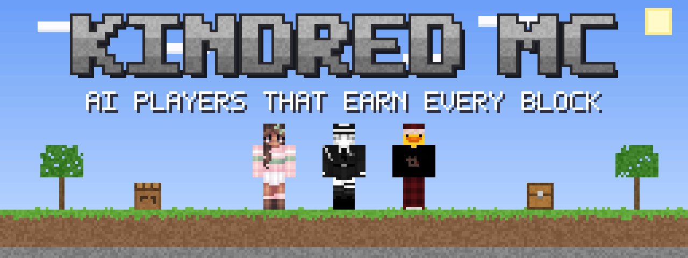

<p align="center">
  
</p>

<p align="center">
  <b>Make a Minecraft player of your own.</b><br>
  It joins your server like a real person and plays survival by your rules: punching trees, crafting, mining, building and fighting its way to the Ender Dragon.
</p>

<p align="center">
  
  
  
  
</p>

---

## 🎮 What is this?

**Kindred MC** is a mod for Minecraft Java servers. It lets you add a player of your own to your world. Your player shows up in the player list, has its own skin and inventory, gets hungry, takes fall damage and respawns when it dies.

**No cheats. Ever.** It doesn't get free items, teleport or see through walls. Everything it has, it found, mined, crafted or smelted itself, by the same rules you play by.

The big goal: **start with an empty inventory and beat the Ender Dragon**, while you play alongside it or just watch.

---

## 🛠️ Make your own

Give it a name, dress it in any skin you like and shape its personality. In game, as an operator:

```text
/aiplayer native create Ada                 make a player called Ada; it appears beside you
/aiplayer skin <skin> Ada                   dress Ada in a skin from the server's config/kindred/skins folder
/aiplayer personality curiosity 90 Ada      tune a trait from 0 to 100
```

The traits are **initiative, caution, curiosity, sociability, humor, combativeness, helpfulness, farming** and **mining**. Right now they change how your player moves and looks around, how it chats and the names it gives its gear. More of its choices will follow them as the project grows.

A server can have up to three of these players at once.

Talk to it by name in chat: `Ada, what are you doing?`. Whoever made it (and any operator) can talk with it at any time; anyone else only once you let it talk in public: `/aiplayer social public true Ada`.

### ⚡ In a hurry? Use a starter

Three ready-made players come with the mod, each with its own name and skin: **Kindred**, **Sol** and **Echo**. Spawn one and get going:

```text
/aiplayer roster spawn Kindred
```

---

## ⛏️ What it can do

> 🚧 **Work in progress.** Most of this works in the automated tests and in test worlds, and is still being proven in long real games. Use a test world and keep backups.

- 🪵 **Start from nothing:** logs, a crafting table and wooden tools, then stone, then iron smelted in its own furnace, then diamonds.
- 🔥 **Get to the Nether:** obsidian made from lava and water, flint and steel, and a lit portal, all earned.
- 🟣 **Head for the End:** blaze rods, ender pearls and eyes of ender. It throws the eyes to triangulate and digs down to the stronghold.
- 🐉 **Fight the dragon:** shoot the crystals with its own bow, open the caged ones and fight the dragon at its perch. This only happens if the server owner allows it.
- 🏠 **Build:** huts, cabins, houses, manors, walled keeps, farms with fields, animal ranches and villager trading halls, all from blocks it gathered.
- 🍖 **Look after itself:** eat when hungry, sleep at night, run from creepers and lava, break long falls with a water bucket, and go back for its stuff after dying.
- ⚔️ **Play games with you:** duels, speedrun races, manhunts and build battles.

---

## 🗺️ Game modes (where it's heading)

| Mode | The idea |
| --- | --- |
| **Co-op Survival** | Play a normal survival world together: bases that grow, farms, enchanting, and boss fights when you're ready. |
| **Manhunt** | Runners race to beat the game while hunters gear up and chase them. People and players you made can be on either side. |
| **Speedrun** | A random seed, and a race to the dragon using the tricks real speedrunners use. |
| **Builder** | A creative build battle on a random theme, judged by votes, minigame-server style. |
| **Factions** *(optional)* | Everyone for themselves: hidden bunkers, walled bases, scouting, and only players who joined are fair game. |

---

## 🚀 Install (for server owners)

There's no download yet, so you build the mod yourself (it takes a couple of minutes):

1. **Get the tools:** [Java 21](https://adoptium.net/) and a Minecraft **1.21.1** server running **Fabric Loader 0.19.5** with **Fabric API 0.116.17+1.21.1**.
2. **Build it:** in this folder, run `./gradlew build` (on Windows: `gradlew.bat build`).
3. **Install it:** copy `companion-server-adapter/build/libs/kindred-mc-0.1.0-SNAPSHOT.jar` into your server's `mods` folder and start the server.
4. **Optional:** put the same JAR in your own game's `mods` folder too. That adds the **K** menu and shows your players' skins. The mod is built so friends with plain vanilla Minecraft can join too (that part is still being tested).
5. **Say hi:** in game, as an operator:

```text
/aiplayer edits on                  let your players break and place blocks (off until you say so)
/aiplayer native create Ada         make your player
/aiplayer goal nether Ada           watch Ada earn its way to a lit Nether portal
```

> 💾 This is a development build. Use a world you don't mind losing, and back up your saves.

---

## ⌨️ Cheat sheet

Press **K** in game (with the mod on your client) to open the player menu, or use commands. `[player]` means you can name one; leave it out if there's only one.

| Command | What it does |
| --- | --- |
| `/aiplayer native create <name>` | Make a player of your own beside you |
| `/aiplayer roster spawn <name>` | Spawn a starter: Kindred, Sol or Echo |
| `/aiplayer skin <skin> [player]` | Dress a player in a skin from `config/kindred/skins` |
| `/aiplayer personality <trait> <0-100> [player]` | Tune one personality trait |
| `/aiplayer edits on` / `off` | Allow or stop all block breaking and placing by your players |
| `/aiplayer goal nether [player]` | Earn a lit Nether portal from scratch |
| `/aiplayer goal end [player]` | Go on to find the End portal |
| `/aiplayer dragonfight on` then `/aiplayer goal dragon [player]` | Allow the dragon fight, then go for it |
| `/aiplayer goal none [player]` | Drop the current goal |
| `/aiplayer build cabin <x y z> [player]` | Build a cabin there (also `hut`, `house`, `manor`, `keep`) |
| `/aiplayer ranch cow <x y z> [player]` | Build a pen and breed a pair of cows (or `sheep`, `pig`, `chicken`) |
| `/aiplayer match duel <first> <second>` | Set up a duel (also `speedrun`, `manhunt`, `build`) |
| `/aiplayer limit cap <hours> [player]` | How many hours a day a player may be active |
| `/aiplayer limit window 18.00 23.00 [player]` | Only let a player be active between those hours |

The full list, with every option, is in the [operator guide](docs/operator-guide.md).

---

## 🧠 How it works (no jargon)

- **A real player, not a mob.** Your player joins the server as an actual player. Same hunger, same mining speed, same tool wear, same everything.
- **A to-do list.** It keeps one list of things it could do and picks the most important: staying alive first (food, sleep, escaping danger), then its goal, then building.
- **Plans from what it has seen.** It only knows about the ores, trees and structures it has actually spotted, like you.
- **A notebook for every important action.** Before it breaks, crafts or moves items, the mod writes down what it's about to do. If the server crashes halfway, nothing gets duplicated and nothing silently vanishes.
- **Off-switches everywhere.** Server owners decide whether players may edit the world, fight the dragon or build their own bases, how long they play each day and at what hours.
- **Runs on your server.** Everything above works on its own. A server owner can optionally plug in a Claude or OpenAI key for extra planning advice on long goals; it's off by default.
- **Talks back in its own words.** With that key plugged in, a player you speak to answers in its own voice from what it actually knows, and only tells you what you're allowed to know; anything goes wrong and it says its usual line. If you're allowed to command it, you can also ask it in chat to come over, wait, stop or toss you something, and it does exactly what the matching command would. Nobody else's chat makes it do anything.

New here? The [**start-here guide**](docs/README.md) explains the project, the folders and the words we use, in plain language.

---

## 📦 What's in this repo

| Folder | What's inside |
| --- | --- |
| [`companion-core/`](companion-core) | 🧠 **The brains.** Decisions, plans, recipes and build plans. It contains no Minecraft code, so it's easy to test. |
| [`companion-server-adapter/`](companion-server-adapter) | ✋ **The hands.** The actual Fabric mod: the players' bodies, the commands, the K menu, and the in-game tests. |
| [`companion-scheduler/`](companion-scheduler) | ⏰ **The clock.** Daily play limits, hours and time zones. |
| [`companion-persistence/`](companion-persistence) | 💾 **The memory.** Saves everything to a small database file. |
| [`companion-model/`](companion-model) | 💡 **The optional planning helper.** Talks to Claude or OpenAI when a key is set. |
| [`companion-testkit/`](companion-testkit) | 🧪 **Demos and test helpers.** |
| [`docs/`](docs) | 📚 **Guides and design notes.** Start with [docs/README.md](docs/README.md). |
| [`assets/`](assets) | 🎨 **Art.** The logo banner, the starter skins and the script that draws the banner. |
| [`tools/`](tools) | 🔧 Helper scripts for checking test reports. |

*Why "companion" in the folder names? That's left over from an earlier version of the project, when these were pet-like companions. The names stay so old saves keep working.*

---

## 🧪 Is it finished?

Not yet. It works in automated tests: hundreds of little test worlds the game builds to check one thing at a time. It's being proven in longer real games, and it isn't ready to run a survival server unattended. Progress is tracked feature by feature in the [tracker](docs/feature-spec.md).

---

## 🛠️ For developers

You'll need Java 21. The Gradle wrapper fetches everything else at the exact versions in [`release-manifest.json`](release-manifest.json).

```bash
./gradlew build                                   # compile everything and run the unit tests
./gradlew :companion-server-adapter:runGametest   # run the in-game tests (starts a real test server)
./gradlew :companion-testkit:run                  # a quick demo of the core pieces
```

The technical documents:
- [The player contract](minecraft_player_spec.md): what a player must do and must never do.
- [Architecture](docs/player-architecture.md): how the pieces fit together.
- [Tracker](docs/feature-spec.md): every feature, its status and its evidence.
- [Operator guide](docs/operator-guide.md): everything a server owner can set.
- [Validation](docs/validation.md): test results, run by run.
- [AGENTS.md](AGENTS.md): the rules for anyone working on the code.
