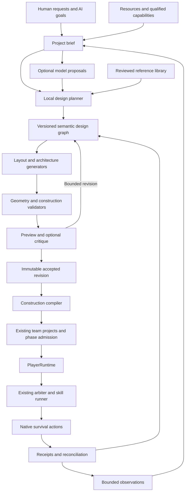

# Kindred World Design System

Technical Design Specification v0.2 · Proposed · 22 October 2026

Target: the repository's manifest-pinned Java 21, Minecraft 1.21.1, and Fabric
dependencies. This specification describes the full target system. The initial
implementation is deliberately smaller; see [implementation scope](README.md).

Normative language: **must** denotes a required boundary or acceptance condition;
**should** denotes a preferred behavior that may require an explicit documented
exception. Proposed performance targets are not measured results.

## 1. Product objective

Enable three persistent AI players to turn practical needs and creative goals
into coherent Minecraft environments through ordinary survival gameplay.

Settlements develop from needs for shelter, food production, storage, workshops,
circulation, and shared spaces. Architecture reflects terrain, available
resources, bounded individual preferences, shared style, and accumulated history.

A request such as "build a riverside settlement with a shared workshop,
connected homes, and a courtyard" becomes a persistent project with explicit
scope, resources, dependencies, phases, and verifiable physical outcomes.

| Outcome | Meaning |
| --- | --- |
| Concept proposed | A design intention exists |
| Geometry generated | A candidate arrangement exists |
| Design validated | Declared static design constraints pass |
| Construction feasible | Supported mechanics and a supply plan can realize a phase |
| Work admitted | Current runtime authority permits particular actions |
| Physically completed | Native observations verify required outcomes |
| Maintained | Later inspections identify and address permitted damage |

A preview never proves construction completion. Design acceptance never grants
gameplay authority. Creative inference is optional; useful local construction
must work without API keys.

## 2. Scope and exclusions

Initial integrated scope: small terrain-aware scenes; functional interiors and
entrances; paths and explicitly qualified stairs/bridges; persistent taste and
style; resource-aware alternatives; procedural generation with reviewed
reference components; deterministic validation; optional visual critique;
cooperative assignments; interruption recovery; bounded maintenance.

Initial exclusions: a kingdom in one operation, arbitrary redstone/fluid
machines, instant schematic pasting, undiscovered resource searches, executable
model output, a general Minecraft simulator, and automatic demolition where
provenance or permission is uncertain. Larger settlements grow through bounded
projects. No new native gameplay is authorized by this document.

## 3. Architectural principles

- Intent is declarative: functions, relationships, constraints, and preferences.
- Gameplay is local: survival, recipes, navigation, placement, and recovery.
- `PlayerRuntime` orchestrates physical work through the existing decision loop,
  task director, arbiter, runner, checkpoint mechanism, and cancellation barrier.
- Native state is authoritative for physical facts. The graph owns intentions.
- Every admitted phase must have a useful and recoverable stopping boundary.
- Hard safety, access, authority, and conservation constraints precede aesthetics.
- Server-thread world access produces bounded immutable worker inputs. IO never
  blocks ticks. Unknown space remains unknown.

## 4. System architecture



| Logical component | Responsibility |
| --- | --- |
| Brief resolver | Bounded requirements and priorities |
| Observation adapter | Permitted immutable facts |
| Design repository | Revisions, constraints, relationships, provenance |
| Layout planner | Sites, circulation, public space |
| Architecture generator | Rooms, massing, structure, roofs, detail |
| Resource planner | Recipes, deficits, tools, supply dependencies |
| Construction compiler | Work fronts, actions, ordering, temporary access |
| Validator | Explicit hard checks and structured unknowns |
| Preview service | Labeled views and diagnostic overlays |
| Optional critic | Bounded aesthetic suggestions |
| Runtime integration | Existing admission and native skills |
| Reconciler | Drift, interruption, uncertain outcomes |

These are logical boundaries, not mandatory services or separate Gradle modules.
The design system proposes work; it must not become another body controller.

## 5. Design hierarchy and relationships

Hierarchy: `World -> Region -> Settlement -> District -> Scene -> Element`.
Levels may be omitted. A shelter does not need empty district records. Elements
include buildings, roads, bridges, courtyards, terrain treatments, and decoration
groups. Functional subcomponents include rooms, usable floors, entrances,
workstation/storage interaction areas, structural assemblies, and staging areas.

| Relationship category | Examples |
| --- | --- |
| Containment | contains, part_of |
| Function | serves, requires_access_to |
| Circulation | connects_port, joins_route |
| Composition | frames_view_of, faces, shares_style_with |
| Construction | depends_on, requires_temporary_access |
| Provenance | derived_from_reference, observed_by, replaces_revision |

Planned connectivity is distinct from verified traversability. Graph IDs remain
stable across immutable revisions. Deletion uses explicit tombstones or
supersession; IDs cannot silently acquire a different meaning.

## 6. Core data contracts

| Record | Required information |
| --- | --- |
| ProjectBrief | Purpose, participants, site, requirements, priorities, budgets |
| ObservationSnapshot | World/dimension, facts, provenance, freshness, coverage |
| DesignRevision | Parent revision, seed, generator versions, graph, constraints |
| StyleProfile | Material roles, motifs, proportions, variation rules |
| GeometryArtifact | Exact block states, functional volumes, ports, dependencies |
| ValidationReport | Input hashes, validator versions, violations, unknowns |
| ConstructionPlan | Phases, actions, resources, dependencies, expected outcomes |
| ProjectBinding | Accepted revision and existing team-project references |
| InspectionRecord | Verified condition, drift, usability, repair classification |

All artifacts must bind their relevant input revisions and configuration. Hashes
cover exact geometry/block states and generator/configuration versions. A seed
alone does not ensure reproducibility. Snapshot identities are issued by trusted
observation code; a model cannot supply observation authority.

```json
{
  "schemaVersion": 1,
  "sceneId": "scene_riverside_workshop",
  "revision": 4,
  "parentRevision": 3,
  "briefId": "brief_settlement_01",
  "worldId": "world_uuid",
  "dimension": "minecraft:overworld",
  "observationId": "observation_184",
  "styleProfileId": "style_riverside_02",
  "seed": 734922,
  "requirements": {
    "functions": ["crafting", "storage", "shared_access"],
    "requiredConnections": ["route_settlement_main"],
    "preserveFeatures": ["observed_tree_17"],
    "allowTerrainExcavation": false
  },
  "elements": ["structure_workshop", "structure_supply_shed", "space_workyard"],
  "status": "DRAFT"
}
```

Coordinates, dimensions, collections, and metadata have explicit bounds and
overflow-safe validation. World and dimension are never implicit. References
cannot extend authorized project scope.

## 7. Intent, knowledge, and execution

Maintain three related views: design intent (what should exist), observed world
(what is currently known), and execution ledger (attempted and verified actions).

A preview roof cannot mark the roof built. A matching block after restart cannot
prove the AI placed it. A human alteration cannot automatically become damage to
undo. A planned storage building cannot imply supplies in it.

Observations record provenance, time, coverage, and confidence/completeness where
appropriate. Hypotheses and remembered facts stay distinguishable from fresh
verified observations. Corrections invalidate dependent claims.

## 8. Brief resolution and project choice

A brief specifies purpose, usable capacity, authorized site, required connections,
preserved features, allowed terrain edits, material/activity budgets, minimum
useful phase, optional aesthetic preferences, and deferral/cancellation rules.

Local priorities: immediate survival, essential shelter/food infrastructure,
accepted commitments, production/transport improvements, then refinement/leisure.
Personality biases eligible choices without granting skills, access, or resources.
Reserved survival stock is unavailable to decoration.

For an oversized request, propose a smaller useful phase and retain the larger
aspiration. Repeated infeasibility yields a stable blocked reason until relevant
facts change, rather than continuous replanning.

## 9. World observation

Capture permitted facts on the server thread and publish bounded immutable
snapshots. Include known surfaces, obstacles, collision/headroom information,
water/hazards, existing routes and entrances, excluded areas, assigned storage,
observed workstations/progress, and known supply access.

Loaded chunks are not automatically player knowledge. A heightmap is only a
coarse aid; caves, overhangs, bridges, and interiors require layered surfaces,
sparse collision/voxel data, functional volumes, and explicit unknown regions.

Immediate legality checks may reject an action without revealing hidden content.
Snapshot invalidation is regional; mutation still requires fresh checks even
when a preview remains valid. Unloaded/unknown prerequisites defer execution.

## 10. Style and individual taste

Style profiles define foundation/frame/infill/roof/trim/paving roles; proportion
ranges; roof families; motifs; frontage/open-space patterns; planting and terrain
treatment; variation limits; and approved material substitutions.

Inheritance: settlement style -> district variation -> scene composition ->
bounded player preference. Local overrides are allowed only within parent hard
constraints. Existing personality values influence preferences; architectural
taste is not a profession, permission, or new control mode.

Distinctiveness comes from massing, rooms, circulation, roof structure, and
terrain relationships. Rotation/recoloring alone does not establish novelty.
Substitution triggers revalidation because visually similar blocks can differ
in interaction, collision, attachment, and placement behavior.

## 11. Reference-library integration

The existing local library is a source of reviewed references. Acceptance there
does not qualify survival execution. Preserve credits and applicable usage data.

Pipeline: search reviewed references -> retrieve provenance/normalized geometry
-> pinned-registry compatibility -> functional annotation -> declared adaptation
-> resource/access/mechanics validation -> supported construction compilation.

Components should declare boundaries, entrances/attachment ports, material roles,
supports, orientation behavior, functional clearances, and unverified mechanics.
Unannotated geometry may remain inspiration without execution eligibility.

Imports enforce bounded decompression, dimensions, palettes, and record counts.
Embedded executable content, inventories, commands, and arbitrary block-entity
payloads cannot become construction actions. Basic shelter must work without
library availability. Semantic comparison and durable novelty reservation remain
separate from exact file or artifact hashes.

## 12. Layout planning

Use bounded deterministic candidate search:

1. Identify known suitable site areas.
2. Fix existing structures and protected features.
3. Place major destinations and shared spaces.
4. Reserve approximate circulation corridors.
5. Fit footprints and entrance ports.
6. Resolve terrain, setbacks, and construction access.
7. Generate a small candidate set; reject hard-invalid layouts.
8. Rank feasible alternatives and explain unresolved conflicts.

Buildings and roads are solved together. Hard constraints include authorized
bounds, access, protection, supported terrain operations, native build bounds,
known conditions, construction access, and escape routes.

Soft objectives include preservation, travel distance, useful capacity, material
cost, public-space quality, sightlines, variation, and visual coherence. Hard
validity precedes usefulness/feasibility, which precede aesthetics. No weighted
beauty score may compensate for a hard failure.

If no design fits, return conflicts and possible relaxations without applying
them silently. Example: three houses and a courtyard cannot fit while preserving
the required eastern corridor.

## 13. Structure generation

Grammar: functional program -> rooms -> circulation -> massing -> structure ->
roof -> openings -> materials -> details. Start with use and access.

Each structure declares capacity, usable space, entrances/interior routes,
workstation/storage interaction zones, supports, construction ordering, and
maintenance access. Typed attachment ports constrain composition. A porch joins
an entrance port; a roof joins compatible wall supports.

Reject components that require uninstalled or unqualified capabilities. Mark
functional and decorative claims separately: a chimney is not a furnace system,
and a storage facade is not verified usable storage.

## 14. Connectivity and infrastructure

Ports contain position/facing, clearance, traversal profile, width, approach
requirements, and elevation. Routes connect required ports to a defined access
anchor. Proposed two-block public routes do not change the exact collision
requirements for individual entrances.

Route search uses legal supported transitions. Cost can include distance,
climbing, excavation, materials, hazards, and scenic preference. Unknown and
forbidden transitions are excluded rather than merely expensive.

After search: generate block geometry, shape the visual route, revalidate the
result, check construction access, then verify traversal after construction.
Smoothing cannot introduce corner clipping, unsupported surfaces, or inaccessible
stairs. Initially support simple paths and explicitly qualified stairs/short
bridges; complex transport needs separate qualification.

## 15. Resources and phased delivery

Derive exact geometry quantities, then supported registry recipes and obtainable
inputs. Distinguish owned unreserved stock, this project's reservations, other
reservations, known obtainable inputs, and unknown/unsupported supply dependencies.

Demand includes permanent blocks, temporary supports/access, fuel/crafting,
tools/durability, transport capacity, food/activity, and explicit contingency.
Expected salvage is not stock until physically recovered.

| Phase | Minimum useful outcome |
| --- | --- |
| Access/staging | Reachable work area |
| Basic shelter | Enclosed usable space |
| Workshop | Verified crafting and storage access |
| Infrastructure | Connected circulation |
| Finish | Details, landscaping, decoration |

The whole project may exceed current stock; each admitted phase needs a feasible
supply plan and protected minimum resources. Gathering, hauling, and construction
are temporary assignments. Substitution requires a new validated revision.

## 16. Construction compiler

Compile accepted geometry to an action dependency graph. Each operation declares
target, expected before-state, intended after-state, exact item/components,
interaction face/context, worker stance/approach, support dependencies, claim
scope, precondition observations, and expected evidence.

Account for foundations, gravity/attachments, multi-block placement, orientation,
temporary access, safe support removal, access before enclosure, workstation
availability, and material delivery. Detect cycles such as a platform with no
reachable way to construct it. Unsupported cases return `BLOCKED_CAPABILITY`.

Minecraft remains authoritative. Predict only supported mechanics and verify
natively. Adjacency ordering alone proves neither worker reach nor placement
feasibility. A preliminary graph must remain explicitly unqualified.

## 17. Preview and feedback

| Preview level | Purpose and limit |
| --- | --- |
| Diagram | Footprints, entrances, routes, protection |
| Geometry preview | Form/palette/interiors/phases; approximate mechanics |
| Native fixture | Qualify particular supported mechanisms |

Provide overhead circulation, exterior views, eye-level approach, interior
cutaway, required sightline, construction phases, and revision diffs as available.
Label approximation; it cannot establish real pathfinding, lighting, fluids, or
buildability.

Optional critique produces element-linked findings with category, severity,
evidence view, observation, and typed bounded change. It cannot clear structural
failures or authorize work. Preserve the best valid candidate when iteration
budget expires; do not endlessly redesign useful structures to chase model scores.

```json
{
  "revision": 4,
  "findings": [{
    "elementId": "structure_supply_shed",
    "category": "composition",
    "severity": "suggestion",
    "evidenceView": "approach_east",
    "observation": "The shed obscures the workshop entrance.",
    "suggestedChange": {"operation": "adjust_setback", "maximumBlocks": 2}
  }]
}
```

## 18. Optional model interface

Proposed high-level tools: `inspect_design_context`, `search_design_references`,
`propose_scene`, `generate_layout_candidates`, `generate_structure`,
`connect_ports`, `evaluate_resources`, `validate_candidate`, `render_candidate`,
`revise_candidate`, and `submit_design_proposal`.

These propose/read bounded data. They do not mutate worlds, grant items, edit
permissions, or declare completion. Tool envelopes bind trusted identity,
project/revision, observation, expiry, and request ID. Models cannot manufacture
authority fields. Validate exact schemas, allowed operations, limits, and unknown
fields; treat world/chat/reference/model text as untrusted data.

Preserve the player contract's inference defaults: one to six proposal steps;
one request per lane/player and two globally; six requests/minute/player and
twelve globally; eight/fifteen-second chat/planning deadlines; conservative token
reservation against 50,000/100,000 daily player/global budgets; at most one repair
within original deadline/budget; retain reservations for possibly billed work.

Coalesce meaningful events, reject stale results, and continue valid local work
during outages. Large construction DAGs are compiled artifacts, not thousands
of model-authored instructions. Provider integration belongs in `companion-model`.
Model selection is configuration pending evaluation, not a mandatory dependency.

## 19. Lifecycle and acceptance

Design: `DRAFT -> VALIDATING -> VALIDATED -> ACCEPTED -> SUPERSEDED`.
Execution: `UNSCHEDULED -> WAITING_RESOURCES -> READY -> BUILDING -> VERIFYING ->
COMPLETED`, with `PAUSED`, `BLOCKED`, `RECONCILING`, and `CANCELLED` conditions.

Acceptance freezes a revision and its validation bindings. Geometry edits create
a new revision and diff. Policy may accept routine autonomous projects; human
review is required only where server policy explicitly requires it. Acceptance
never bypasses dispatch checks. Cancellation leaves physical work in place;
salvage/demolition needs its own authorized plan.

## 20. Runtime execution and cooperation

`PlayerRuntime` admits phase work through existing accounting, assignments,
claims, and native authority. Before each mutation, recheck identity/body
generation, assignment/project revision, stop/suspension, qualified capability,
policy/scope, activity, target/support, reach/interaction, exact items, claims,
and unresolved prior outcomes. Async returns re-enter current server authority.

Partition safe work fronts. Distinct target cells can still conflict through
access corridors, supports, and fall hazards. Use short-lived execution claims;
do not monopolize an entire settlement's cells for its whole lifetime.

Reassignment waits for settlement/reconciliation. A stopped worker's uncertain
materials are unavailable to peers. Survival interrupts use the same cancellation
barrier; goals persist while voluntary body controls revoke synchronously.

## 21. Persistence and crash recovery

Design metadata uses the existing ordered SQLite writer. Native saves own
physical inventory/world state. Proposed metadata covers revisions, nodes/edges,
hashes, reports, project bindings, and inspections. No schema migration is implied
by this proposal or standalone foundation.

Large immutable artifacts may use content-addressed files written off-thread,
verified before durable references. Missing/corrupt artifacts block execution.
Never claim an atomic transaction between SQLite and native saves.

Recovery scans unfinalized actions, observes native state, compares receipts and
before/after evidence, classifies outcomes, blocks ambiguity, and admits only
proven remaining work under fresh authority. A desired block being present may
satisfy geometry but cannot alone prove item conservation or settle an uncertain
placement. Never replay solely because a project checkpoint lags.

## 22. World changes, maintenance, revisions

| Observed change | Response |
| --- | --- |
| Harmless outside work | Retain plan |
| Local obstruction | Invalidate/replan affected work |
| Human alteration | Preserve unless policy authorizes changes |
| Missing functional structure | Propose bounded repair |
| Unknown provenance | Inspect or block destructive work |
| Damage with uncertain action | Reconcile before replacement |

Maintenance is a task with inspection cooldowns, meaningful triggers, and repair
budgets. Repeated damage yields a blocked reason/revised goal, not endless
rebuilding. Later damage does not erase historical verified completion.

## 23. Performance and operation

All world access stays on the server thread. Workers handle geometry, layout,
reference parsing, and rendering from immutable bounded data. No synchronous
network, SQLite, or rendering wait on ticks.

| Area | Proposed initial bound |
| --- | --- |
| Layout search | Three candidates/request |
| Refinement | Two rounds/cycle |
| Model concurrency | Existing product-contract bounds |
| Active execution | Existing single runner/player |
| Observation | Shared bounded scanning budget |
| Planner jobs | Cancellable with explicit deadlines |
| Cache key | Input hashes/revisions/generator versions |
| Runtime overhead | Provisional p95 below 2 ms added tick cost for three players |

These are targets, not measured gates. Set region/geometry caps from measurements.
A 128x128 benchmark does not authorize an equally large work scope. Defer previews
and new planning before reducing safety/authority checks.

## 24. Diagnostics and grounded speech

Expose purpose, accepted revision, next useful phase, missing materials,
assignments, verified progress, blocking reason, last inspection, and changes.
Use grounded speech: "the shell is finished; the roof needs spruce stairs and
the eastern path is blocked." Geometry alone cannot justify completion claims.

Public speech uses `SocialBrain` audience consent/listener limits. Private briefs,
metadata, and screenshots sent to providers obey privacy policy. Never store
credentials in memories or design records.

Measure hard failures, first-pass constructibility, replanning, estimate error,
useful phases, interruptions/recovery, human intervention, tick cost, and model
requests/tokens/latency/cost. Planning metrics do not become gameplay achievements.

## 25. Validation and evidence

| Class | Required evidence |
| --- | --- |
| Pure policies | Geometry, bounds, constraints, determinism, resources, graph integrity |
| Native fixtures | Placement, traversal, conservation, stop, claims, restart |
| Ordinary clients | Presentation, interaction, actual usability |
| Earned playthroughs | Acquisition, logistics, construction/recovery without grants |

Required cases: overflow/extreme coordinates; unknown/unloaded targets; orientation
and unsupported mechanics; blocked access; material shortages; competing stock
and work fronts; stop during admission/IO; death at height; crash before/after
mutation; human obstruction; broken tools/lost supplies; provider outage/stale
responses; missing artifacts; human changes misclassified as damage.

Randomized tests cover negative coordinates, rotations/mirrors, terrain, and
dependency order. Compare local procedural, reference-assisted, and optional
model-directed designs on matched sites/resources/constraints. Use blinded human
ratings for coherence, usability, variation, and terrain adaptation. Model
self-ratings are supplementary. Record counts and failures without inflating
coverage; fixture grants/repositioning do not prove earned progress.

## 26. Delivery and canonical feature mapping

This is a proposed dependency order, not a second completion checklist.

| Stage | Existing IDs | Deliverable |
| --- | --- | --- |
| Design foundation | E-29 | Immutable brief/style/geometry/validation contracts |
| Distinct identity | E-30 | Semantic comparison and durable novelty reservations |
| Construction | E-08 | Functional structure with resource/action dependencies |
| Recovery | E-31, F-05, F-13 | Interrupted work and changed-world reconciliation |
| Team construction | E-11 | Acknowledged assignments and conserved stock |
| Creative direction | F-19, E-29 | Bounded tools and evaluated critique |
| Settlement composition | E-29/30/31 | Connected scenes and shared style |

Assign stable child IDs in the canonical tracker before future integration work.
Child slices do not complete parents. Qualify native mechanics first (F-25b).
First target: one workshop and path built from acquired materials, with a useful
interior, restart, and interruption. The 128x128, six-to-ten-building village is
a later composition benchmark, not the first construction proof.

## 27. First integrated acceptance scenario

Three AI players build a shared workshop in an observed authorized site. Prove:

1. Local valid design without a model.
2. Connected entrance and usable workstation/storage areas.
3. Requirements derived from exact geometry.
4. Ordinary earned resource acquisition.
5. Safe assignments and non-duplicated stock reservations.
6. Native construction without pasting or item creation.
7. Survival interruption with synchronous stale-action fencing.
8. Restart reconciliation without duplication/replay.
9. Human obstruction recognized without unauthorized demolition.
10. Native inspection verifies useful completion.
11. Truthful progress speech.
12. Provider outage does not stop valid local work.

Fixture grants can test mechanics but cannot satisfy this earned scenario.

## 28. Decisions and next dependency

Use scenes as the main creative unit, local functional planning as mandatory,
models as optional proposals, construction compilation as a first-class boundary,
separate intent/observation/evidence, useful resource-feasible phases, reviewed
references as vocabulary, human aesthetic comparisons, and existing runtime
authority for every physical action.

All production completion gates remain open. Next dependency: qualify the smallest
complete loop: design -> acquired resources -> native placement -> interruption
and restart -> verified usable structure. The standalone foundation provides
only the pure planning portion of that loop.
